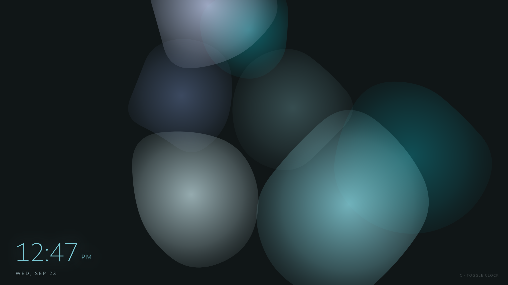
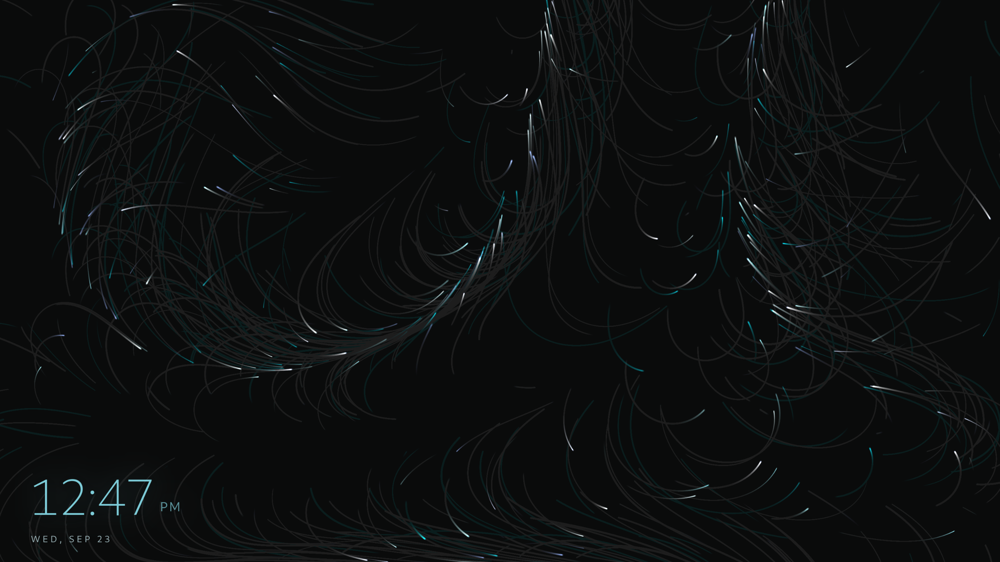
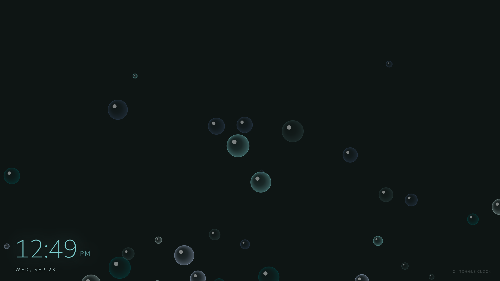

<div align="center">


# Material Screensaver

**Animated ambient scenes for GNOME on Wayland.**

31 offline HTML/JavaScript screensavers with a GTK4 and libadwaita settings app.

[Features](#features) · [Install](#install) · [Controls](#controls) · [Documentation](#documentation)

</div>

## Preview

| | |
|---|---|
|  |  |
| **Liquid Blobs** | **Origami** |
|  |  |
| **City** | **Bubbles** |

## Features

- **31 scenes** across abstract, geometric, space, and nature-inspired styles.
- **GNOME integration** with idle activation and multi-monitor support.
- **Scene controls** for search, categories, favorites, random selection, and per-scene options.
- **Clock overlay** and configurable keyboard shortcuts.
- **Power controls** with frame-rate limits, battery saver, and display blanking.
- **Reduced motion** support, limiting animated scenes to 10 FPS when enabled.
- **Offline by default:** bundled scenes require no network connection.

> **Not a lock screen.** Use GNOME's session lock to secure your computer.

## Requirements

- GNOME on Wayland
- Python 3 with PyGObject
- GTK 4, libadwaita, and WebKitGTK 6.0 GI bindings

Install the corresponding packages from your distribution.

## Install

From the repository checkout:

```sh
./install.sh
```

Log out and back in once for GNOME Shell to discover the extension. Then launch **Material Screensaver Settings** from Activities.

## Controls

Choose a scene and configure idle timeout, frame rate, battery saver, favorites, and clock options in Settings.

The command-line controller is also available:

```sh
~/.local/bin/material-screensaver-ctl.py start
~/.local/bin/material-screensaver-ctl.py stop
~/.local/bin/material-screensaver-ctl.py toggle
```

Add custom scenes as `.html` files in `~/.local/share/material-screensaver/screensavers/`. See the [scene authoring guide](docs/scene-authoring.md) and [starter template](docs/scene-template.html).

## Documentation

- [Troubleshooting and configuration](docs/troubleshooting.md)
- [Scene authoring](docs/scene-authoring.md)
- [GNOME Wayland integration test plan](docs/gnome-integration-test-plan.md)
- [Changelog](CHANGELOG.md)

## Uninstall

```sh
./uninstall.sh
```

Keep settings for a future reinstall with `./uninstall.sh --keep-settings`.

## Development

Run the automated checks:

```sh
python3 -m unittest discover -s tests -v
python3 scripts/validate-scenes.py
python3 scripts/check-scene-payload-budget.py
```

Live GNOME Wayland testing is still required for visual and lifecycle behavior. See the [integration test plan](docs/gnome-integration-test-plan.md).

## License

GPL-3.0-only. See [LICENSE](LICENSE). Third-party assets and dependencies may have separate licenses.
