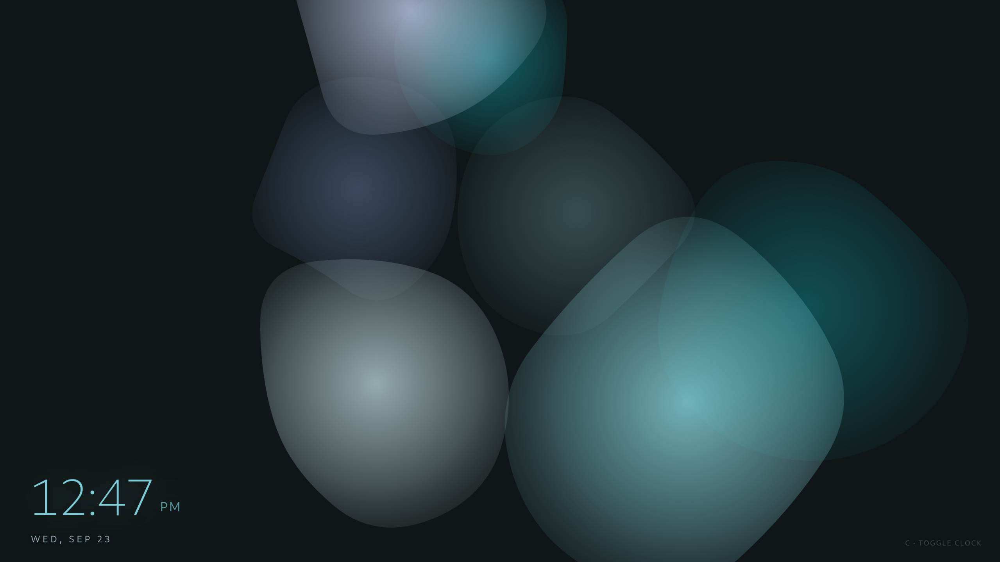
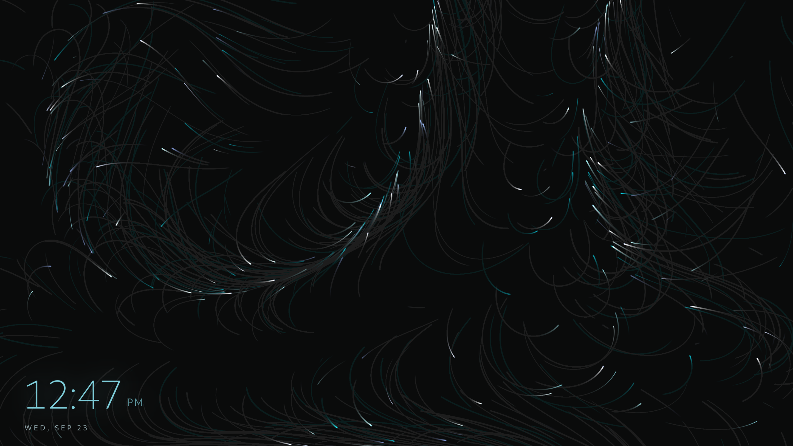
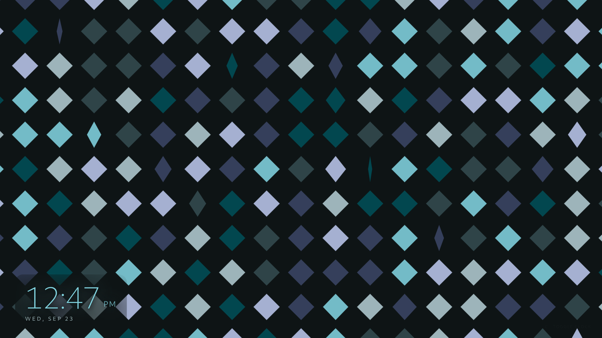
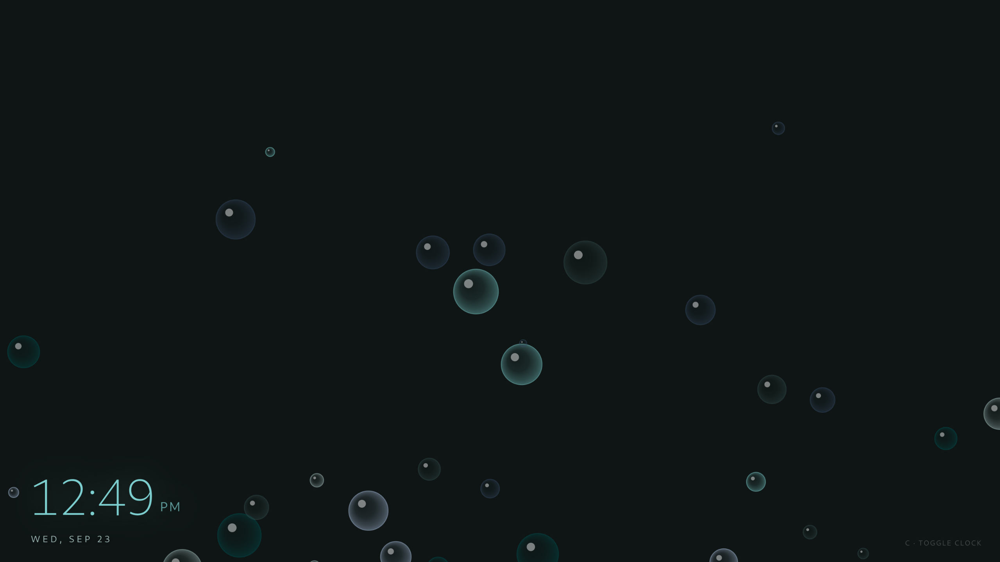

<div align="center">


# Material Screensaver

**Ambient animated scenes for GNOME on Wayland.**

A lightweight collection of 31 offline HTML/JavaScript screensavers, with a GTK4 and libadwaita settings app.

[Features](#features) · [Install](#install) · [Quick start](#quick-start) · [Documentation](#documentation)

</div>

## Preview

A few scenes from the collection:

| | |
|---|---|
|  |  |
|  |  |

## Features

- **31 animated scenes** spanning abstract, geometric, space, and nature-inspired visuals.
- **GNOME integration** with idle activation and multi-monitor support.
- **Settings app** with search, categories, favorites, random selection, per-scene options, and a clock overlay.
- **Quick controls** including a configurable shortcut and `Super+Q` to dismiss the viewer.
- **Power options** including a configurable frame-rate cap, battery saver, and display blanking.
- **Reduced motion** support for the system preference.
- **Offline by default:** bundled scenes do not need a network connection.

> Material Screensaver is not a secure lock screen. Use GNOME's normal session-lock mechanism to lock your computer.

## Requirements

- GNOME on Wayland
- Python 3 with PyGObject
- GTK 4, libadwaita, and WebKitGTK 6.0 GI bindings

Package names vary by distribution. Install the GTK4, libadwaita, WebKitGTK 6.0, and Python GI packages provided by your distribution.

## Install

From the repository checkout:

```sh
./install.sh
```

Log out and back in once so GNOME Shell discovers the companion extension. Then open **Material Screensaver Settings** from Activities.

## Quick start

Open Settings to choose a scene and adjust the idle timeout, frame-rate cap, battery saver, favorites, and clock options.

You can also control the viewer from a terminal:

```sh
~/.local/bin/material-screensaver-ctl.py start
~/.local/bin/material-screensaver-ctl.py stop
~/.local/bin/material-screensaver-ctl.py toggle
```

To add a scene, place an `.html` file in `~/.local/share/material-screensaver/screensavers/`. Read the [scene authoring guide](docs/scene-authoring.md) and use the [starter template](docs/scene-template.html).

## Documentation

- [Troubleshooting and advanced configuration](docs/troubleshooting.md)
- [Scene authoring guide](docs/scene-authoring.md)
- [GNOME Wayland integration test plan](docs/gnome-integration-test-plan.md)
- [Changelog](CHANGELOG.md)

## Uninstall

From the repository checkout:

```sh
./uninstall.sh
```

To preserve your application settings for a future reinstall:

```sh
./uninstall.sh --keep-settings
```

## Development

Run the automated checks:

```sh
python3 -m unittest discover -s tests -v
python3 scripts/validate-scenes.py
python3 scripts/check-scene-payload-budget.py
```

These checks do not replace visual and lifecycle testing in a live GNOME Wayland session; see the [integration test plan](docs/gnome-integration-test-plan.md).

## License

GPL-3.0-only. See [LICENSE](LICENSE). Third-party assets and dependencies may have separate notices or licenses.
