# Material Screensaver


A collection of animated, Matugen-themed screensavers for GNOME on Wayland, with a GTK4/libadwaita settings app.

Since GNOME no longer provides a native animated-screensaver framework, Material Screensaver displays standalone HTML/JavaScript scenes in a fullscreen WebKitGTK 6.0 window on each monitor. Its user service watches for idle time through Mutter's D-Bus idle monitor and can launch the viewer automatically. While visible, the viewer inhibits session idle handling and grabs input. **Super+Q dismisses the viewer**; ordinary input does not close it, although interactive scenes can respond to input within the page.

## Included styles

Solar System, Starfield, N-Body Galaxies, Cymatics, Kaleidoscope, Magnetic Field Lines, Strange Attractor Flow, Soft-Body Creatures, Blob, Flow, Bounce, Game of Life, Wave-Function Collapse, Circuit Board, Glitch, Constellation, Voronoi, Origami, Paper Cranes, Sakura, Lanterns, Rain, Bubbles, City, Autumn Leaves, Fireworks, Typewriter, Quantum Interference (GLSL/WebGL), Organic Harmonic Field (GLSL/WebGL), Metaphysical Horizon, and Rain on a Window — **31 styles**.

The scenes use a Matugen-generated stylesheet so their colors follow your wallpaper-derived Material You palette. The default stylesheet path is `~/.config/matugen/matugen-colors.css`; if Matugen is not configured or the file is absent, scenes retain their built-in fallback colors.

Shared helpers are available for new styles:
- `screensavers/clock-shared.js` — clock utilities.
- `screensavers/theme-shared.js` — theme color parsing and `rgba()` helpers.

## Screenshots

| | | |
|---|---|---|
| 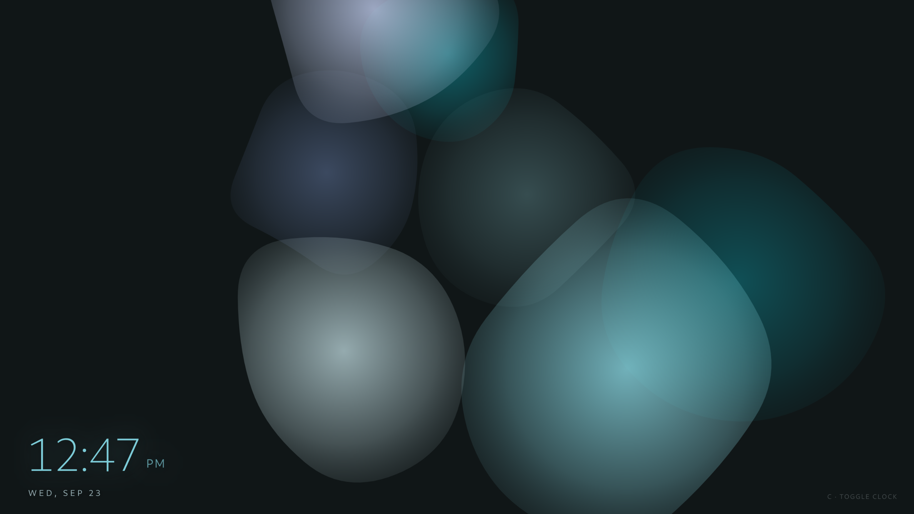 | 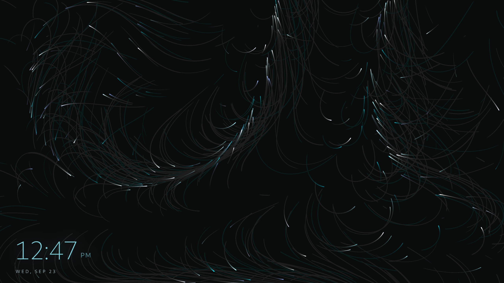 | 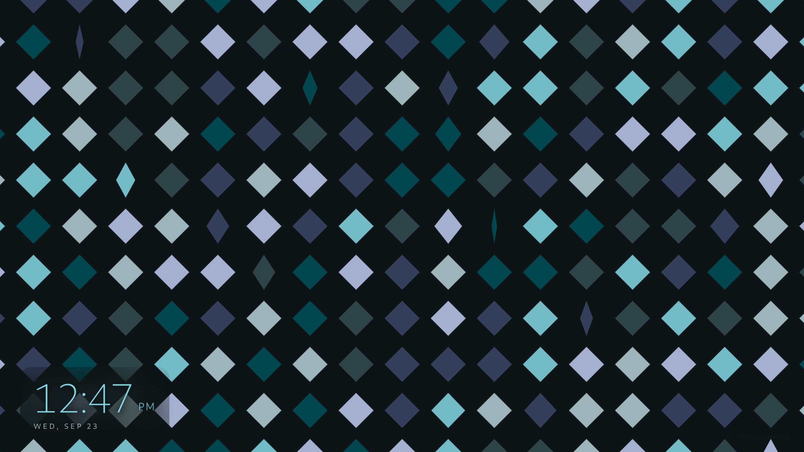 |
| 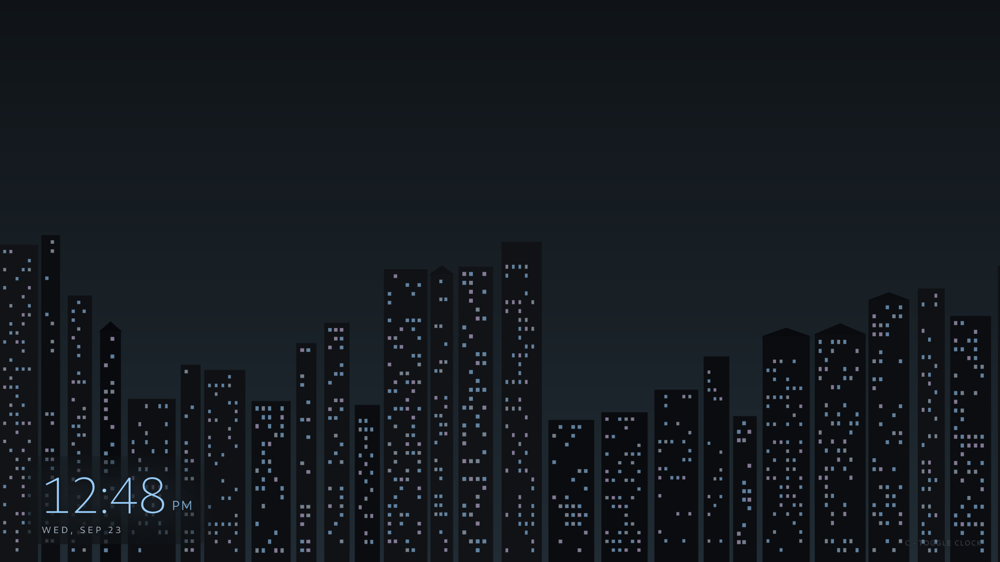 | 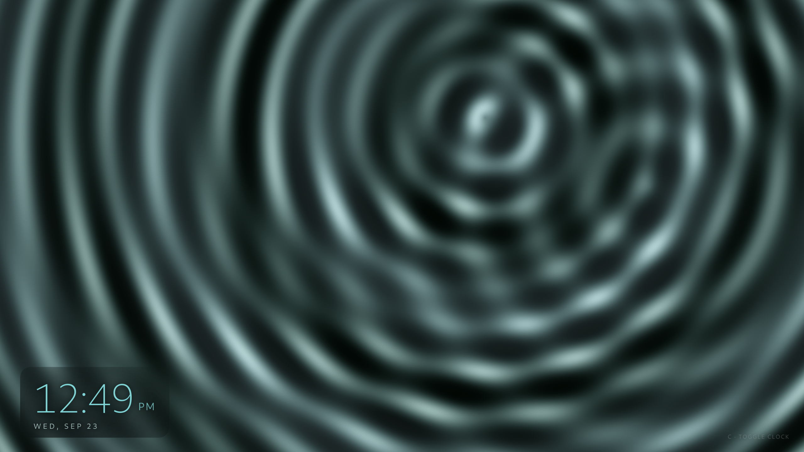 | 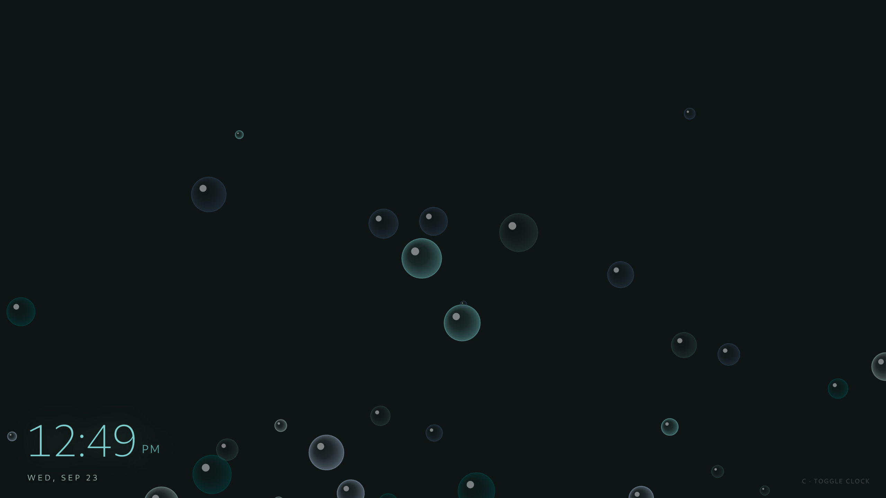 |
| 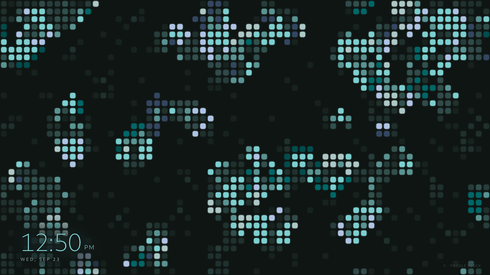 | 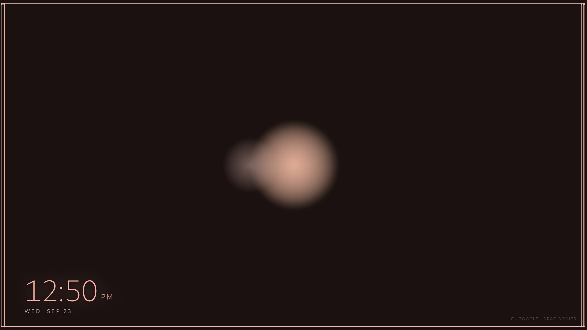 | 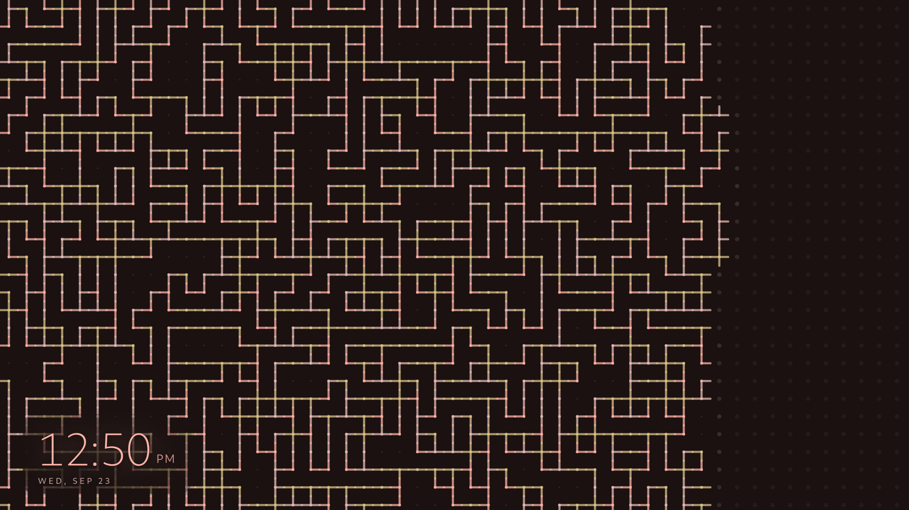 |
| 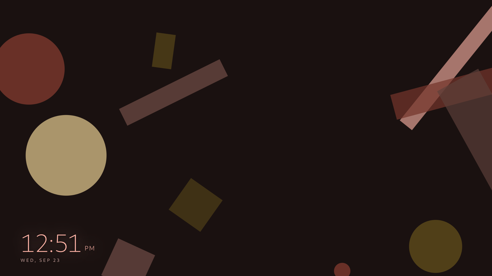 | 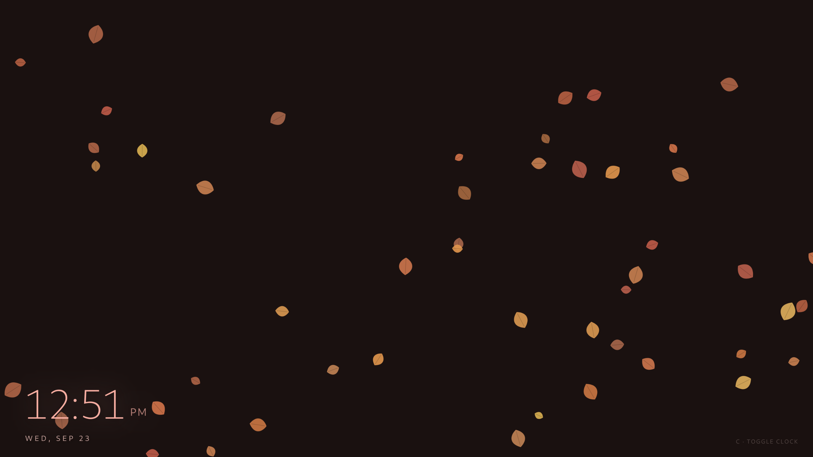 | 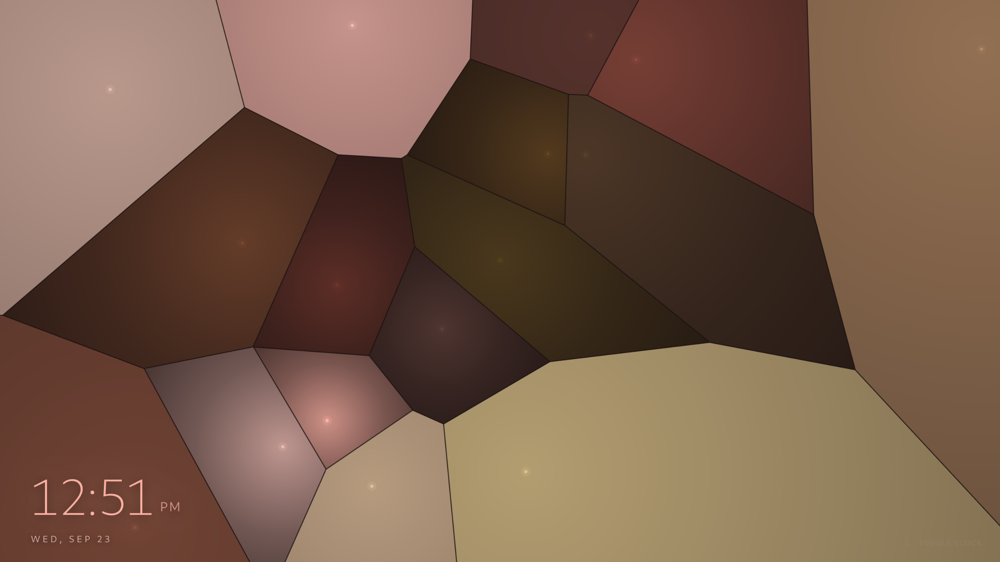 |
| 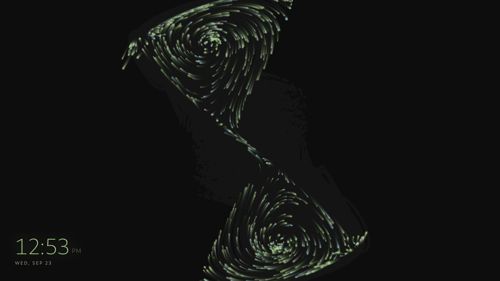 | 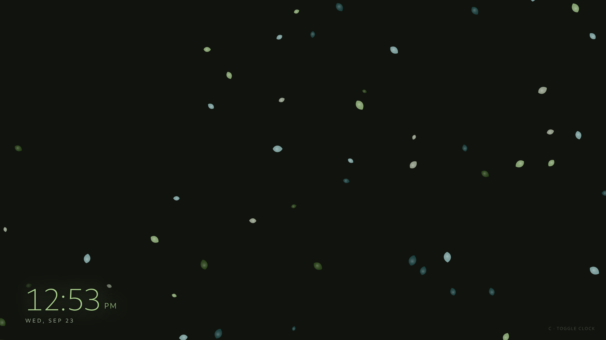 | |

## Requirements

- GNOME on **Wayland**; automatic idle detection uses `org.gnome.Mutter.IdleMonitor`.
- Python 3 with PyGObject, GTK 4, libadwaita, and **WebKitGTK 6.0** GI bindings.
- Matugen is optional; when configured, it should generate `~/.config/matugen/matugen-colors.css`.
- A running graphical GNOME session is required to display the viewer or open the settings GUI.

No external browser or network connection is required for the included scenes. Solar System uses Canvas 2D; the previous Three.js CDN dependency has been removed.

Package names vary by distribution. On Fedora, install the GTK4/libadwaita and WebKitGTK 6.0 Python/GI packages from your enabled repositories; on Debian/Ubuntu-based systems, the corresponding packages commonly include `python3-gi`, `gir1.2-gtk-4.0`, `gir1.2-adw-1`, and `gir1.2-webkit-6.0`.

## Install

From the repository directory:

```sh
./install.sh
```

The installer copies the scripts, screensaver scenes, icons, desktop entry, and user systemd service into your home directory. It also installs and enables the companion GNOME Shell extension that suppresses three-finger touchpad gestures while the fullscreen viewer is focused.

The installer attempts to enable and start `material-screensaver.service` immediately. If it reports that no user bus is available, run this after logging into your graphical session:

```sh
systemctl --user daemon-reload
systemctl --user enable --now material-screensaver.service
```

After a fresh installation, **log out and back in once** so GNOME Shell discovers the companion extension. The settings app should then be available from Activities as **Material Screensaver Settings**.

## Configure

Open **Material Screensaver Settings** from Activities, or run:

```sh
~/.local/bin/material-screensaver-gui.py
```

The settings app lets you:

- choose a specific screensaver or enable **Random each time**;
- set the idle timeout (default: 5 minutes);
- set **Lock after**, the time the screensaver remains visible before locking the GNOME session (default: 5 minutes; set to 0 to disable);
- choose a 12-hour or 24-hour clock;
- set a keyboard shortcut to show or hide the viewer;
- enable or disable automatic idle-triggered launching.

To add a new scene, place an `.html` file in `~/.local/share/material-screensaver/screensavers/`; the picker discovers HTML files in that directory automatically.

## Manual control

The control script is installed at `~/.local/bin/material-screensaver-ctl.py`:

```sh
material-screensaver-ctl.py start    # show the screensaver
material-screensaver-ctl.py stop     # hide it
material-screensaver-ctl.py toggle   # show if hidden; hide if visible
material-screensaver-ctl.py daemon   # run the idle watcher (normally started by systemd)
```

The viewer is dismissed with **Super+Q**. The configured keyboard shortcut can toggle it, and `stop` can also hide it from the command line. If the daemon is running, control commands delegate to it; otherwise, they start a standalone viewer.

## Uninstall

To stop and remove the user service, scripts, scenes, icons, desktop entry, and
companion GNOME Shell extension, run the repository's `uninstall.sh` before
deleting the source checkout:

```sh
bash uninstall.sh
```

The uninstall script removes only Material Screensaver's own extension UUID and
preserves other enabled GNOME extensions and `~/.config/material-screensaver`
user settings. Log out and back in if GNOME Shell still has the extension loaded.

## Tests

Run the test suite from the repository root:

```sh
python3 -m unittest discover -s tests -v
```

The suite includes Python configuration and scheduling tests, installer/desktop-entry checks, HTML structure and theme-link checks, and JavaScript syntax checks. It does not fully test live interaction with a running GNOME session, including Mutter idle-watch registration, SessionManager inhibition, or locking a real session. For the repeatable live-session test matrix, see [GNOME Wayland integration test plan](docs/gnome-integration-test-plan.md).
